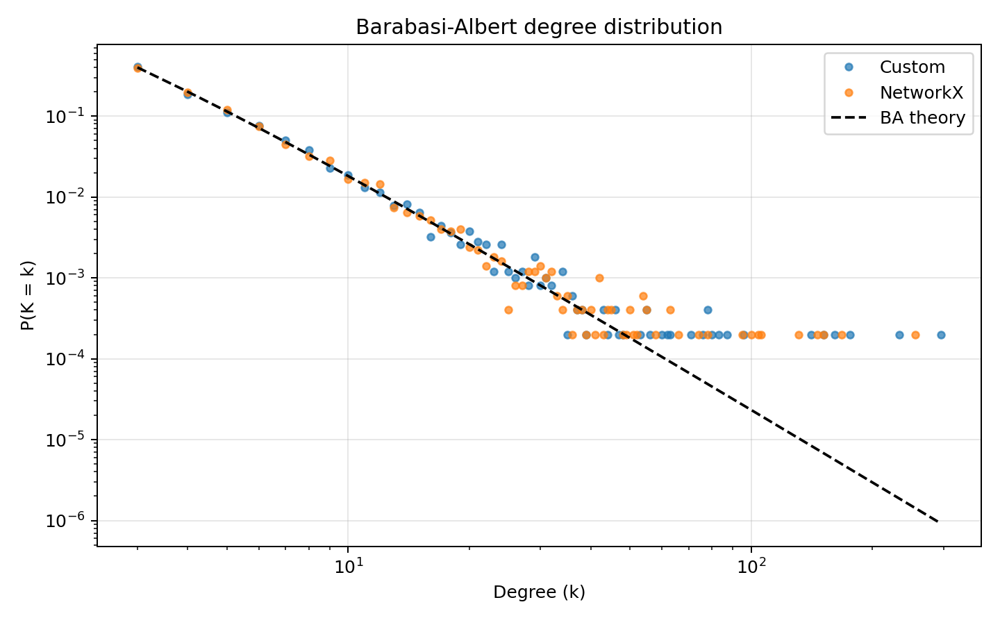
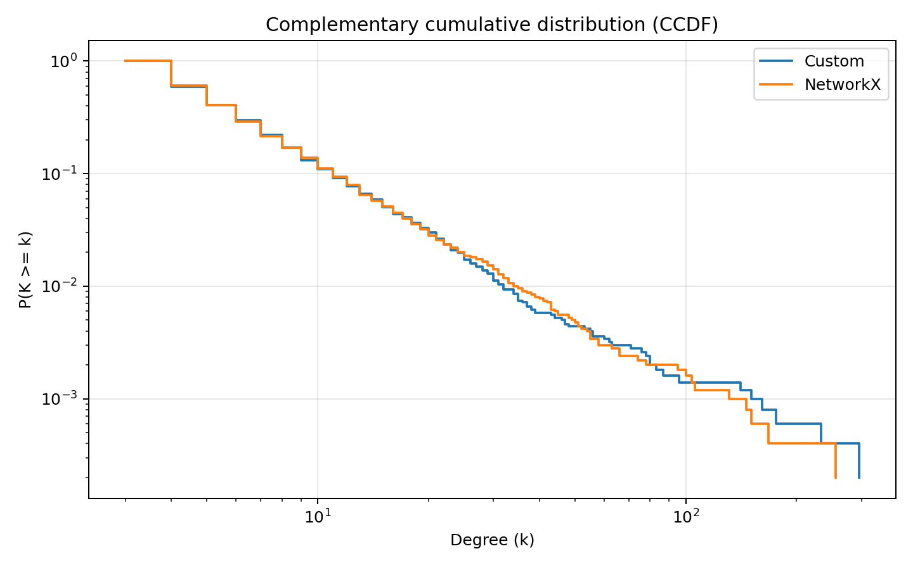

# Barabási–Albert Network Simulation

A small Python project to study **preferential attachment** in the Barabási–Albert (BA) network model.

## Aim

Generate a BA network using a manually implemented attachment rule and compare its degree distribution with NetworkX's built-in BA generator.

## Method

- Start with a complete graph of `m + 1` nodes.
- Add one node at a time, connecting it to `m` distinct existing nodes.
- Select existing nodes in proportion to their degrees (preferential attachment).
- Compare two independently generated networks using the degree distribution and its complementary cumulative distribution (CCDF).

The custom algorithm uses **NetworkX to store the graph**, but does not use its BA graph generator. The reference network is generated with `nx.barabasi_albert_graph()`. Both simulations start from the same type of complete graph. Their random seeds differ, so their individual links will not be identical.

## How to run

Install `networkx` and `matplotlib`, or use:

```bash
pip install -r requirements.txt
```

Open **`ba_simulation.py`** in Spyder and press **F5**. All results are saved in the `output/` folder next to the script.

Default settings: `N = 5000` nodes, `M = 3` connections per incoming node, and `SEED = 42`. You can change them near the beginning of the Python file (`N > M >= 1`).

## Results

For `N = 5000` and `M = 3`, both networks have 5000 nodes and 14994 edges. The average degree is therefore 5.9976. Their maximum degrees and degree frequencies can differ because they are random realizations.

**Degree distribution:**



The dashed line is the theoretical BA degree distribution for a large network,

\[
P(k) = \frac{2m(m+1)}{k(k+1)(k+2)}.
\]

For large `k`, this behaves approximately as `k^-3`.

**Complementary cumulative degree distribution:**



## Files

- `ba_simulation.py`: network generation, basic checks, plots, and CSV export
- `output/degree_distribution.png`: degree distribution comparison
- `output/degree_ccdf.png`: CCDF comparison
- `output/degrees.csv`: node degrees for both simulated networks, suitable for a later statistical analysis project
- `output/summary.csv`: network sizes and basic degree statistics
- `requirements.txt`: Python dependencies

## Limitations

This is an **educational simulation**, not evidence that an observed real-world network is scale-free. The results use one simulated network per method. A log–log plot alone is not a statistical power-law test. Estimating a power-law exponent with maximum likelihood and testing goodness of fit are left for a separate project.

## Reference

Barabási, A.-L. & Albert, R. (1999). *Emergence of Scaling in Random Networks*. Science, 286, 509–512. https://doi.org/10.1126/science.286.5439.509
