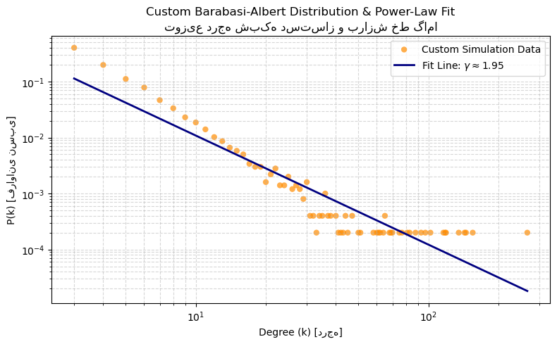

# Barabási-Albert Scale-Free Network Simulation

This project simulates the **Barabási–Albert (BA) model** for generating scale-free networks based on two core mechanisms: **growth** and **preferential attachment**.

## Features
- **Implementation from Scratch:** Built the growth and preferential attachment mechanisms purely using Python and random choices without relying on pre-built graph generators.
- **NetworkX Benchmark:** Verified results against NetworkX's built-in `barabasi_albert_graph`.
- **Power-law Verification:** Plotted the degree distribution $P(k)$ on a log-log scale and fitted a line to calculate the exponent $\gamma$, confirming theoretical convergence ($\gamma \approx 3$).

## Results
- **Theoretical Exponent:** $\gamma = 3.0$
- **Simulated Exponent:** $\approx 2.8 - 3.1$

### Degree Distributions
| Custom Implementation | NetworkX Implementation |
|:---:|:---:|
|  |  |

## How to Run
```bash
pip install networkx matplotlib numpy
python ba_from_scratch.py
